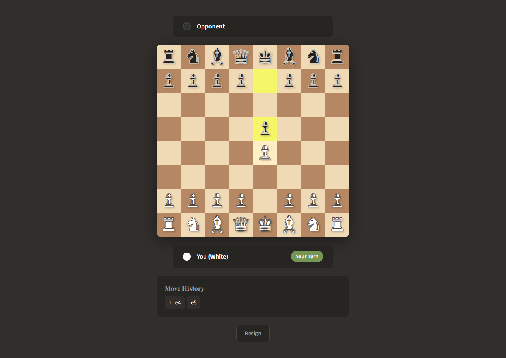

# Chess Multiplayer

A two-player chess app built with React, Socket.IO and chess.js. Create a room, share its six-character code, and play from two browser tabs or connected devices. The server validates each move and broadcasts the same position to both players.



## Try it locally

Prerequisite: Node.js 22.12 or later with npm, matching the [Vite runtime requirements](https://vite.dev/guide/). Clone this repository, then open two terminals.

**Terminal 1 — game server**

```sh
cd server
npm ci
npm start
```

**Terminal 2 — browser app**

```sh
cd client
npm ci
npm run dev
```

Open the address Vite prints (normally `http://localhost:5173`) in **two tabs**. In the first tab select **Create Game**, copy the room code, and enter it in the second tab before selecting **Join**. The creator plays White. Select a piece, then a highlighted destination.

The Vite development server proxies `/socket.io` to `127.0.0.1:3001`. No account or API key is needed. This repository provides a local demo; a hosted public game is not configured.

## What you can explore

- Room creation and joining without recreating the socket when a player's color changes.
- Server-authoritative legal moves, turn enforcement, check and checkmate.
- Castling and en passant through chess.js legal-move handling; the browser auto-promotes pawns to queens.
- Draw detection, resignation and opponent-disconnect results.
- Board orientation for each player, selectable squares with accessible labels, and move history.
- Leaving a completed game and creating a new room on the same connection.

## How it works

```text
React browser A ── Socket.IO ── Node server + chess.js ── Socket.IO ── React browser B
                               validates the move
                               stores the room in memory
                               broadcasts FEN + result
```

`client/src/App.jsx` owns the browser connection and renders the board. `server/index.js` owns room membership and the authoritative chess position. The client proposes a move; the server accepts or rejects it.

One subtle bug to learn from: putting `playerColor` in the socket effect's dependency list caused React to disconnect and recreate the socket immediately after creating or joining a room. The connection now lives for the component's lifetime; room events update the UI independently.

## Run the checks

Install dependencies in both directories first. From `client`:

```sh
npm test
npm run build
```

The integration tests start an isolated server on a free port and connect two real Socket.IO clients. They cover shared positions, invalid/out-of-turn moves, waiting-room validation, answering check, resignation, new-room creation, disconnects before the first move and checkmate. They shut down their own server afterward.

## Current scope

Rooms are stored in memory and disappear when the server restarts. Reconnecting starts a new session; there is no game resume, authentication, rating system, chess clock, spectator mode or underpromotion picker. Disconnecting ends an active game. These constraints make this a small learning project rather than a hosted competitive service.

For a hosted setup, serve the client build over HTTPS and proxy `/socket.io` to the running server with WebSocket support, or set `VITE_SOCKET_URL` to the server's public origin before building. The server defaults to loopback and port 3001; configure `HOST`/`PORT` for your host. Add origin restrictions and abuse controls before exposing a public server.

## Follow the work

For more small React debugging examples and tested project updates, [follow Deepshekhar on GitHub](https://github.com/deepshekhardas). If you encounter a reproducible bug, an issue with the move sequence and browser details is useful.
